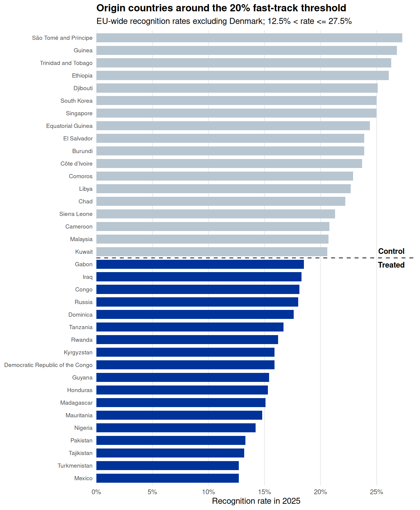
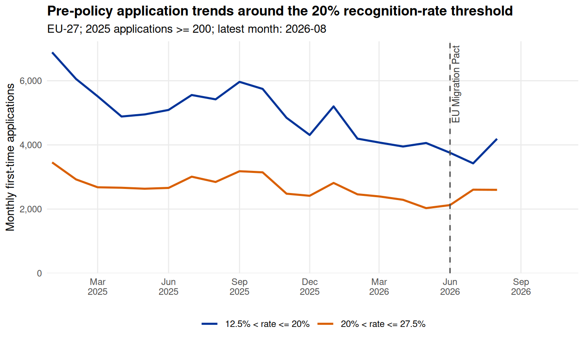
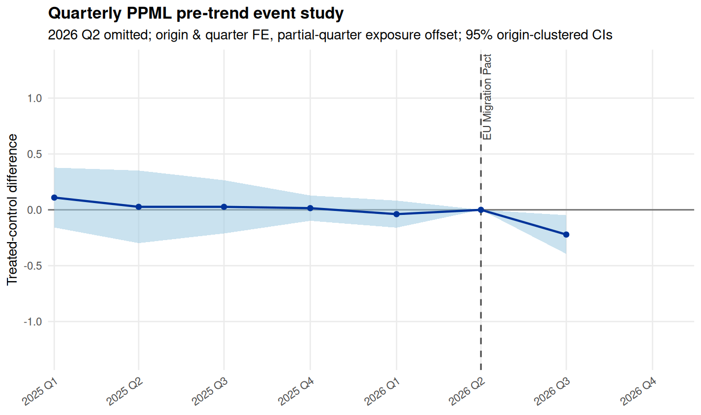
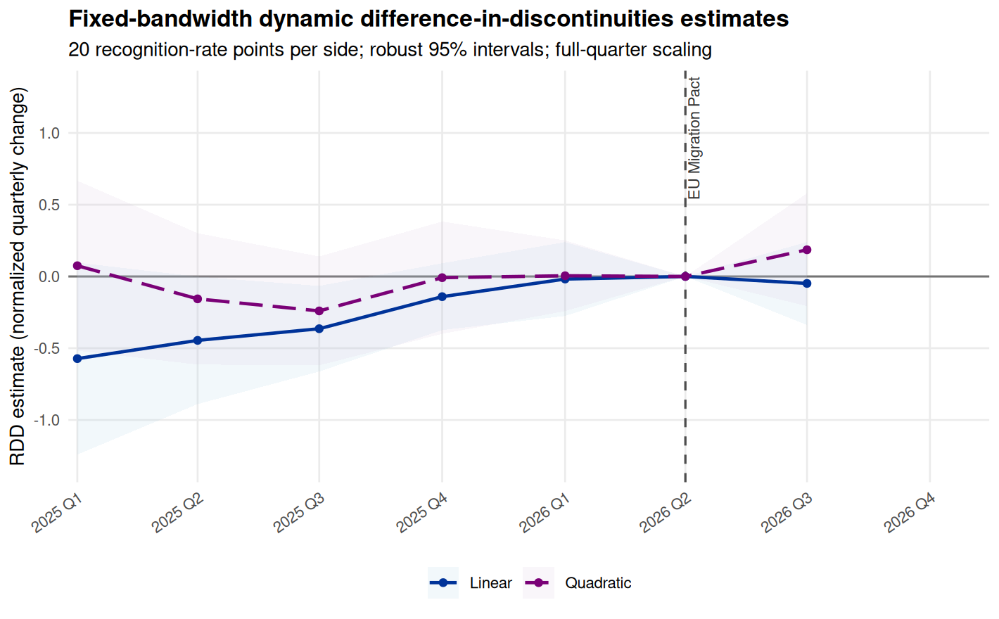
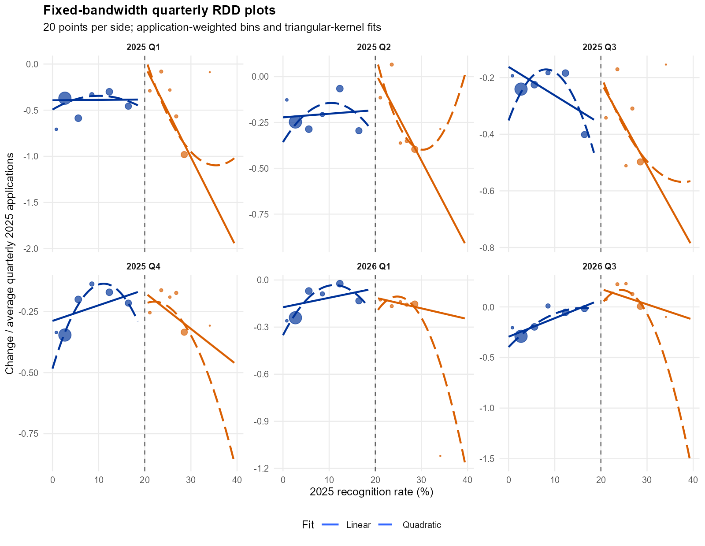
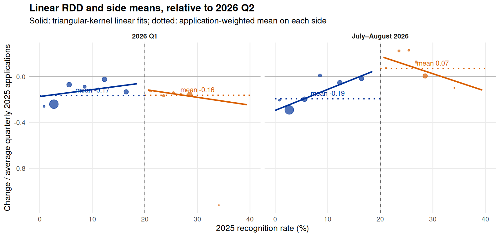
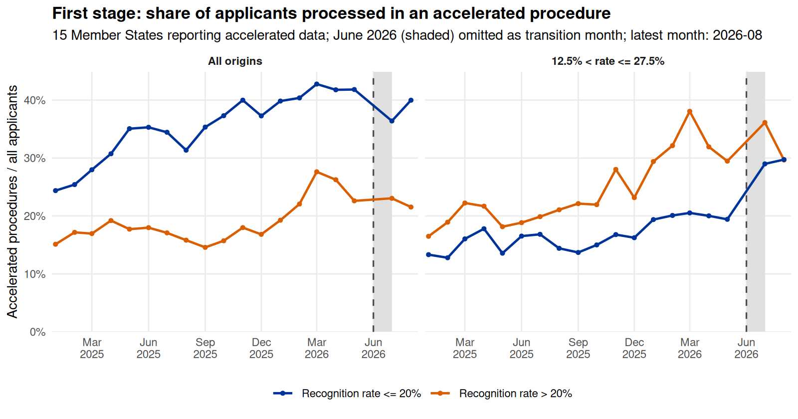
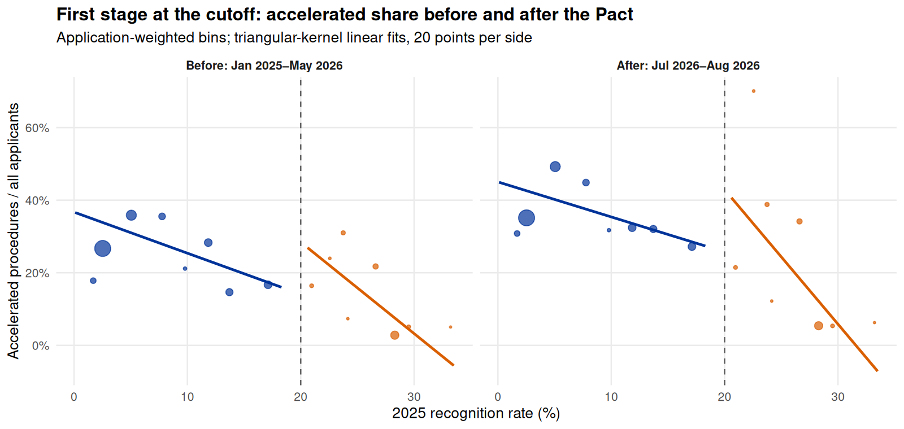

```{r}
#| label: setup
#| echo: false
results <- jsonlite::read_json("results_summary.json", simplifyVector = TRUE)
fq <- results$focus_quarters
fq_pre <- fq[!fq$post_policy, ]
fq_post <- fq[fq$post_policy, ]
f2 <- function(x) sprintf("%.2f", x)
fs <- results$first_stage
pct <- function(x) sprintf("%.0f%%", 100 * x)
pp <- function(x) sprintf("%.1f", 100 * x)
```

> **Preliminary.** Data through **`r results$data_vintage`**. Last successful update: **`r results$last_successful_update`**.

## Setting and research idea

Under the EU's new Asylum Procedure Regulation (2024/1348), applications must be examined in an accelerated procedure (first-instance decision within three months) whenever the EU-wide recognition rate of the applicant's nationality in the latest annual Eurostat data is 20% or lower (Art. 42(1)(j)); applicants who apply at the external border are, within each Member State's capacity, channelled into the border procedure instead (max 12 weeks, appeal included; Art. 45). Either way, the procedure is considerably shortened. The rule creates a sharp, numerical, and publicly announced eligibility threshold: origins just below 20% face a faster procedure than origins just above it. This note tracks whether that eligibility change shifts the number of asylum applications from affected countroes. This allows us to study the effect of EU-wide policies on asylum applications, which typically can't be done; single-EU country policy evaluations on asylum applications can only identify relative effects because of diversion.  The rule entered into force June 2026, so everything shown here is still pre-policy: the exercise validates that treated and control origins were not already trending apart before the cutoff bites. 


## Research design

The note runs **two complementary designs** side by side. The first is a **difference-in-differences**: origins with a 2025 recognition rate between 12.5% and 20% (treated by the cutoff) are compared to origins between 20% and 27.5% (control), using a Poisson (PPML) event study with origin and quarter fixed effects. The second is a **dynamic difference-in-discontinuities**: at each quarterly horizon, it compares the change in EU-wide applications for origins just below the 20% cutoff against origins just above it, relative to the most recent (reference) quarter, using a fixed 20-percentage-point bandwidth with triangular-kernel local-linear and local-quadratic fits on each side. The first design is simpler and does not depend on local smoothing; the second uses a wider 0-40% support and treats the cutoff itself, rather than the 12.5-27.5% band, as the source of identification. Agreement between the two is a stronger pre-policy check than either alone. A **first-stage check** asks whether the cutoff actually changes the procedure: it compares the share of applicants processed in an accelerated procedure for origins below and above 20%, before and after June 2026. Data on applications, recognition rates and accelerated procedures originate from eurostat.

<details><summary>Technical details</summary>

The running variable is the 2025 EU-wide recognition rate minus 20. The sample keeps origins with a 2025 recognition rate strictly above 12.5% and at or below 27.5%, and at least `r results$min_pretreatment_applications` EU-wide applications in 2025 (`r results$n_treated` treated, `r results$n_control` control origins as of this update). For quarterly horizon *l*, the outcome is the change in that origin's applications relative to the reference quarter *r* = `r results$reference_quarter`, normalized by the origin's average quarterly 2025 applications: `(Y_r - Y_l) / (Y_2025 / 4)` for horizons before the Pact's application date, and `(Y_l - Y_r) / (Y_2025 / 4)` for horizons at or after it -- so a pre-policy value above zero and a post-policy value above zero both read as movement in the same, policy-consistent direction. Both `Y_l` and `Y_r` are rescaled to a full-quarter-equivalent by `3 / months observed` whenever a quarter is incomplete, so a partial reference or partial current quarter is not mechanically under-counted relative to complete quarters. The PPML event study applies the same exposure adjustment as a regression offset, `log(months observed / 3)`, rather than rescaling counts directly. Standard errors are clustered by origin country throughout. The data vintage advances automatically to the latest month for which at least `r 100 * results$min_reporting_coverage`% of EU Member States have reported any observations. Member States that have not yet reported that month are left out of all periods rather than counted as zero (`r if (nzchar(results$non_reporting_member_states)) paste0("currently ", results$non_reporting_member_states) else "currently none"`), so application totals are sums over the remaining Member States. The sample window, quarter count, and axis extent all update on their own as new Eurostat releases arrive -- nothing here is pinned to a calendar date except the Pact's own June 2026 entry into force.

</details>

## Preliminary results

@fig-cutoff shows where the `r results$n_treated + results$n_control` origins in the 12.5-27.5% window actually sit relative to the 20% cutoff -- the dashed line marks the threshold, with treated origins (accelerated) below it and control origins above it. @fig-trends plots the raw monthly application totals for the two groups; both have been drifting down over 2025-26 without an obvious break yet, but volumes and composition differ, so this alone is not evidence of parallel trends. @fig-ppml is the difference-in-differences design's quarter-fixed-effects event study: the treated-control gap is close to zero in every pre-reference quarter and never statistically distinguishable from it. @fig-rdd is the dynamic difference-in-discontinuities design's main estimate, plotted on the same y-axis scale as @fig-ppml for direct comparison: linear and quadratic fits agree that the gap has been converging toward zero as the reference quarter approaches, with wide, overlapping confidence bands throughout.

<details><summary>Figure 1: origin countries around the 20% cutoff</summary>

{#fig-cutoff}

</details>

{#fig-trends}

{#fig-ppml}

{#fig-rdd}

<details><summary>Explainer: what's behind Figure 4 (the local RDD fits)</summary>

Each panel of the figure below is one quarterly horizon's cutoff comparison: origin-level normalized changes plotted against the 2025 recognition rate, with application-weighted bins and the triangular-kernel linear/quadratic fits that @fig-rdd summarizes into a single treated-minus-control estimate per quarter. It's the diagnostic view behind the headline numbers, useful for checking that no single origin or outlier is driving a quarter's estimate.

{#fig-rdd-panels}

</details>

@fig-rdd-means zooms in on two periods: the last quarter before the Pact (`r fq_pre$label`) and the latest data after it (`r fq_post$label`), with linear fits only. Each is compared with `r results$reference_quarter`, the quarter in which the Pact took effect; an incomplete quarter is labelled by the months it covers and scaled to a full-quarter equivalent. The outcome is the same as in @fig-rdd-panels. The dotted lines are the application-weighted mean change on each side of the cutoff across the full 20-point bandwidth, so the gap between them compares all treated with all control origins in the bandwidth, much like a simple first difference. The gap between the two solid lines at 20% is the RDD estimate, which uses only the variation close to the cutoff.

In `r fq_pre$label`, the treated-side mean is `r f2(fq_pre$mean_treated)` and the control-side mean `r f2(fq_pre$mean_control)`, and the linear RDD estimate is `r f2(fq_pre$linear_rdd_estimate)` (95% CI `r f2(fq_pre$linear_rdd_ci_low)` to `r f2(fq_pre$linear_rdd_ci_high)`). Just before the Pact, the side means differ by `r f2(round(fq_pre$mean_treated, 2) - round(fq_pre$mean_control, 2))` and the fits show essentially no jump at the cutoff. (For pre-policy quarters the change is signed reference minus horizon, as in @fig-rdd-panels.) In `r fq_post$label`, the treated-side mean is `r f2(fq_post$mean_treated)` against `r f2(fq_post$mean_control)` on the control side, so treated origins as a group lost applications relative to control origins. The linear RDD estimate is much smaller, `r f2(fq_post$linear_rdd_estimate)` (95% CI `r f2(fq_post$linear_rdd_ci_low)` to `r f2(fq_post$linear_rdd_ci_high)`). In the data through `r results$data_vintage`, the treated-side decline is largest among origins with recognition rates far below 20%, and the treated-side fit rises toward the cutoff. The gap in means therefore reflects how treated and control origins differ in general more than a jump at the threshold itself. One partial post-policy quarter is too little to tell these apart.

{#fig-rdd-means}

### First stage: does the cutoff change the procedure?

The designs above estimate the effect of *eligibility* for fast-track processing. That eligibility only matters if Member States actually apply the accelerated procedure to origins below the cutoff, which the regulation makes mandatory but which depends on implementation, capacity, and the regulation's escape clauses. This check uses Eurostat's count of applicants processed under the accelerated procedure, divided by all (first-time and subsequent) applicants in the same month, pooled over the Member States that report accelerated-procedure data.

```{r}
#| label: first-stage-text
#| echo: false
#| results: asis
if (isTRUE(fs$available)) {
  rd_txt <- if (is.na(fs$rd_estimate)) "could not be estimated in this update" else
    paste0(pp(fs$rd_estimate), " percentage points (95% CI ", pp(fs$rd_ci_low), " to ", pp(fs$rd_ci_high), ")")
  cat(paste0(
    "Before the Pact (", fs$pre_window, "), ", pct(fs$share_pre_treated),
    " of applicants from origins at or below the 20% cutoff were processed in an accelerated procedure, against ",
    pct(fs$share_pre_control), " for origins above it. Since July 2026 (", fs$post_window, ", ",
    fs$n_post_months, " month", if (fs$n_post_months > 1) "s" else "", " of data), these shares are ",
    pct(fs$share_post_treated), " and ", pct(fs$share_post_control), ". ",
    "A difference-in-differences regression of the monthly accelerated share on treated × post, with origin and month fixed effects and application weights, gives a first stage of ",
    pp(fs$did_estimate), " percentage points (SE ", pp(fs$did_se), ") across all ", fs$n_origins,
    " origins, and ", pp(fs$did_window_estimate), " (SE ", pp(fs$did_window_se), ") within the 12.5-27.5% window used above (",
    fs$n_window_origins, " origins). ",
    "The local-linear RDD estimate of the jump in the pre-to-post change at the cutoff is ", rd_txt, ". ",
    "Member States included: ", fs$member_states, "; accelerated data through ", fs$data_vintage, ". ",
    if (nzchar(fs$states_without_accelerated_data))
      paste0("No accelerated-procedure data reported before the Pact: ", fs$states_without_accelerated_data, ". ") else "",
    if (nzchar(fs$states_without_recent_data))
      paste0("Reported before the Pact but not for ", fs$data_vintage, " (excluded): ", fs$states_without_recent_data, ".") else "",
    "\n"
  ))
} else {
  cat(paste0("*The first-stage check is pending: ", fs$message, ".*\n"))
}
```

```{r}
#| label: first-stage-trends-plot
#| echo: false
#| fig-cap: "Share of applicants processed in an accelerated procedure, origins below vs above the 20% cutoff"
if (isTRUE(fs$available) && file.exists("figures/fig7_first_stage_trends.png")) {
  
}
```

```{r}
#| label: first-stage-rdd-plot
#| echo: false
#| fig-cap: "Accelerated share against the 2025 recognition rate, before and after the Pact"
if (isTRUE(fs$available) && file.exists("figures/fig8_first_stage_rdd.png")) {
  
}
```

<details><summary>Origins in the 12.5-27.5% window: accelerated share before and after</summary>

```{r}
#| label: first-stage-table
#| echo: false
if (isTRUE(fs$available) && length(fs$window_origins)) {
  tab <- as.data.frame(fs$window_origins)
  tab$share_pre <- pct(tab$share_pre)
  tab$share_post <- pct(tab$share_post)
  knitr::kable(tab, col.names = c("Origin", "2025 recognition rate (%)", "Accelerated share, before",
                                  "Accelerated share, after", "Applicants, after"),
               align = "lrrrr")
}
```

</details>

<details><summary>Caveats on the first-stage measure</summary>

The numerator counts applicants whose application was processed under an accelerated procedure in a given month, the denominator all applicants lodged (from July 2026: registered) in that month, so this is a flow ratio rather than a cohort share and can exceed 100% in single months. June 2026 is dropped as a transition month: Eurostat flags June data as split between the old guidelines and the Pact's new Asylum Manual and incomplete for some Member States (e.g. Spain). From July 2026 applicants are counted at registration rather than lodging and the data reach Eurostat via the EU Asylum Agency, so the level shift at June 2026 mixes the policy with a measurement break; the treated-minus-control contrasts difference out breaks common to both groups, but not breaks that differ by origin. The 20% rule is not the only ground for acceleration (safe countries of origin, subsequent applications, misleading the authorities, etc.), so control origins' share need not be zero, and the EU safe-countries-of-origin list overlaps with low-recognition origins. Whether border-procedure cases are also counted as accelerated may differ by Member State, and Denmark (opt-out, different definition) is excluded. Note that the same June 2026 measurement break and the incomplete June data also affect the application counts used in the designs above; quarter fixed effects absorb the common part.

</details>

## Conclusion

With `r results$n_treated` treated and `r results$n_control` control origins, the event study design has reasonable power: the most recent complete pre-reference quarter's PPML estimate is `r results$latest_pretrend_estimate` (SE `r results$latest_pretrend_se`). Because PPML is a log-linear model, that estimate reads on the percentage scale as a `r sprintf("%.1f", (exp(results$latest_pretrend_estimate) - 1) * 100)`% pre-trend (95% CI `r sprintf("%.1f", (exp(results$latest_pretrend_estimate - 1.96 * results$latest_pretrend_se) - 1) * 100)`% to `r sprintf("%.1f", (exp(results$latest_pretrend_estimate + 1.96 * results$latest_pretrend_se) - 1) * 100)`%) -- small enough to detect a moderate-sized effect, so the PPML design should have real power to pick up a genuine fast-track deterrent once post-policy data arrive. The dynamic difference-in-discontinuities estimates are far more imprecise, so most of that power comes from the PPML side rather than the RDD one, even though the RDD is arguably better identified. However, as every year in January the recognition rates list updates, every january becomes a new natural experiment, which will allow us to gradually build evidence, as some treated countries become control and vice versa. Let the data flow in!

Two extensions are worth flagging even at this pre-policy stage. First, the composition of applicants near the cutoff may itself respond to the rule: an origin just below 20% faces accelerated screening, which could raise its recognition rate the following year if weaker claims are filtered out disproportionately, pushing that origin back above the threshold. Repeated across years, this would produce a zigzag in treatment status -- origins alternating between treated and control as their own recognition rate reacts to the prior year's exposure -- which threatens designs that compare a given origin's treatment status across years, including the difference-in-differences. The RDD is less exposed to this, since it re-identifies the discontinuity within each year's cutoff rather than tracking a given origin's status over time. Second, applicants who prefer to avoid the border procedure altogether have an incentive to evade detection at the border and travel onward to register in a different, typically more western, Member State. That kind of diversion would not show up in recognition-rate composition but would show up in the geographic distribution of first registrations, which is worth examining directly once enough countries report application counts by Member State of registration.

<details><summary>How this page updates itself</summary>

Once a month, a GitHub Actions workflow checks Eurostat's bulk data files for a new release, reruns the versioned R analysis script (`update.R`), and re-renders this Quarto note. If the new data pass validation -- enough Member States reporting, no broken joins -- the workflow commits the refreshed figures, results, and this page straight to the repository, and GitHub Pages serves the update automatically. Nothing here is edited by hand: the same code that produced the numbers above produces every future update, and the full history of past versions stays visible in the repository's commit log.

</details>

---

**Sources:** [Eurostat `migr_asydec1pc`](https://ec.europa.eu/eurostat/databrowser/product/view/migr_asydec1pc) (first-instance decisions) · [Eurostat `migr_asyappctzm`](https://ec.europa.eu/eurostat/databrowser/product/view/migr_asyappctzm) (applications) · [Eurostat `migr_asyaccm`](https://ec.europa.eu/eurostat/databrowser/product/view/migr_asyaccm) (accelerated procedures) · **Code:** [update.R](https://github.com/JopieAdema/JopieAdema.github.io/blob/master/living-research/eu-migration-pact/update.R) · **Contact:** [j.a.h.adema94@gmail.com](mailto:j.a.h.adema94@gmail.com)
